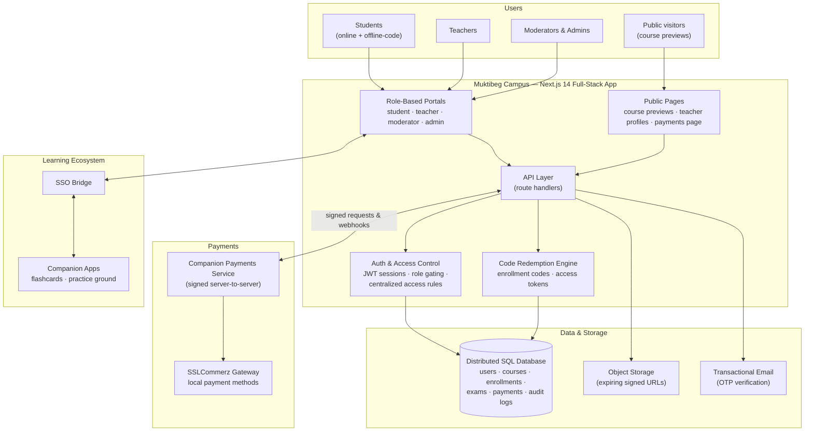

# Muktibeg Campus · Multi-Sided EdTech SaaS Platform

[](#)
[](#tech-stack)
[](#tech-stack)
[](#financial--payment-strategy)
[](#tech-stack)
[](#live-demo--media)

> **A bilingual course marketplace where Bangladesh's teachers run their own online academies — and students learn, practice, and pay the local way.**

**Muktibeg Campus** (Bengali: মুক্তিবেগ ক্যাম্পাস) is a production EdTech SaaS platform that digitizes the coaching-education economy of Bangladesh. It gives independent teachers the tools of a full online academy — courses, batches, lecture libraries, exams, and monetization — while giving students a single campus for their HSC, engineering, and medical admission preparation.

The platform is deliberately built for its market: a **Bengali-first, bilingual interface** (English/বাংলা), **offline-first enrollment** via teacher-issued access codes for students without email or cards, **local payments** through Bangladesh's dominant gateway, and a **multi-sided revenue model** that lets the platform, teachers, and content all earn.

It operates as the centerpiece of a wider learning ecosystem, connected via single-sign-on to the companion **Muktibeg flashcard & practice apps** (see the [ecosystem showcase](https://github.com/AliRezaBmeDu/flashcard-ecosystem-architecture)).

---

## About This Repository

This is a **client-facing architecture showcase**. The production source code lives in a **private repository** to protect the product's intellectual property.

What this repository documents — at a level of abstraction appropriate for clients, collaborators, and technical reviewers:

- what the platform does and who it serves,
- how the teacher-student marketplace and its role system work,
- the financial design: subscriptions, packages, and the code-based redemption engine,
- the high-level architecture and technology choices behind each layer.

No API keys, database credentials, payment-gateway credentials, infrastructure addresses, or proprietary business logic are (or ever will be) shared here.

## Table of Contents

1. [Target Audience & Business Value](#target-audience--business-value)
2. [Key Features](#key-features)
3. [Financial & Payment Strategy](#financial--payment-strategy)
4. [High-Level Architecture](#high-level-architecture)
5. [Tech Stack](#tech-stack)
6. [Live Demo & Media](#live-demo--media)
7. [Repository Structure](#repository-structure)
8. [Security Notes](#security-notes)
9. [About the Developer](#about-the-developer)

---

## Target Audience & Business Value

**Who it serves.**

- **Independent teachers & coaching businesses** — the supply side. Teachers apply, are vetted by the platform, then run their own digital academy: course pages, batches, lecture materials, exams, and their own student base. Many teach offline first; the platform gives them an online storefront without needing to build one.
- **HSC & admission candidates** — the demand side. Students preparing for Bangladesh's Higher Secondary Certificate and university/medical admission tests consume lectures, PDFs, exams, and progress analytics — in their own language, on cheap devices, often without a credit card.
- **The platform operator** — Muktibeg, which monetizes both sides while curating quality through approvals, moderation, and audit trails.

**Why it works as a business.**

- **Multi-sided revenue.** Student subscriptions, teacher capacity packages, and peer-to-peer teacher sales run in parallel (see [Financial & Payment Strategy](#financial--payment-strategy)) — the platform earns from both sides without inserting itself into every teacher transaction.
- **Offline-first onboarding.** Teacher-issued access codes let students without email or payment cards join in seconds — critical reach in this market, and a growth loop: every teacher brings their own students.
- **Bilingual by design.** A Bengali-first interface with an English toggle matches how the audience actually reads, rather than forcing English-only ed-tech conventions.
- **Quality governance at scale.** Teacher vetting, content-approval workflows, complaint handling, and full audit logging keep a marketplace trustworthy as it grows — the operational moat of any course platform.
- **Content velocity.** Teachers publish lecture documents, video sessions, routines, and exams themselves; the platform never becomes the content bottleneck.

---

## Key Features

**Role-based portals (one platform, four experiences)**

- **Student dashboard** — "My Courses" (lectures, videos, PDFs, routines, calendars, notices), attendance history, exam results, and visual progress reports.
- **Teacher dashboard** — course & batch management, lecture builder, student roster, exam creation & evaluation, package & access-code management, public teacher profile.
- **Moderator & admin consoles** — teacher-request review, enrollment approvals, course-delete requests, complaint handling, takedown review, notifications, and platform-wide student management.

**Course & content management**

- Courses organized into **batches**; lectures shared across batches without duplication.
- Lecture topics combine **PDF documents** (secure object storage with expiring signed download URLs), **embedded video sessions** (with start/end trimming), rich metadata, and per-topic visibility controls.
- Free-preview topics power **public course pages** and interactive course cards on the payment page — a built-in marketing funnel.
- Teachers request course deletion; only the platform approves — every destructive action is cascade-safe and **audit-logged**.

**Enrollment & the access-code (coupon) engine**

- **Online enrollment** with moderator/admin approval workflow.
- **Offline enrollment codes** — teachers generate short alphanumeric codes (optionally batch-tied, pre-allocated, or expiring); a student redeems one to get an instant account and course access, no email or password needed.
- **Online access tokens** — seat-based codes a teacher issues from purchased capacity; a token's access window only starts **at redemption**, not at issue.
- **Free-access tokens** — batch-scoped, expiring giveaway codes for promotions.
- Full code lifecycle: generate → distribute → redeem → track seats used/remaining → revoke or disable at any time.

**Assessment & community**

- Teacher **question banks**, live/active exams, timed submission, and an evaluation workspace.
- **Discussion forum** with posts, comments, and moderation.
- **In-app notifications** (bell + unread badge) from the platform to teachers/students, plus system events.
- Attendance tracking with per-student history and summary stats.

**Trust, safety & governance**

- Teacher onboarding with **email-OTP verification** and admin approval (or Google-account promotion).
- **Complaint & takedown system** — including verification flows for external content owners — reviewed by admins, with automated scheduled processing.
- **Audit logs** on every sensitive action; admin-side freeze levers for teacher package abuse.

---

## Financial & Payment Strategy

The platform runs three complementary revenue legs, all built on local-payment realities rather than card-first assumptions.

**1. Student premium subscriptions (B2C).**
A site-wide subscription unlocks premium courses, lectures, and materials. Checkout runs through **SSLCommerz**, Bangladesh's leading payment gateway, accepting the local payment methods students actually have (mobile financial services, cards, net banking). The gateway integration is mediated by a companion payments service: the platform initiates a purchase with **cryptographically signed, timing-safe-verified server-to-server requests**, identity is always taken from the authenticated session (never from client input), prices are validated server-side, and activation happens through **signed webhooks with idempotent transaction records** — the same payment never grants access twice.

**2. Teacher capacity packages (B2B).**
Teachers buy seat-and-duration capacity (e.g. "50 seats × 30 days") from the platform through the same secure gateway flow. A configurable **approval gate** holds a teacher's first or oversized purchase in an admin review queue before activation — protecting students from unvetted sellers while keeping normal repurchases instant.

**3. Peer-to-peer teacher sales (P2P, platform-facilitated).**
Students pay teachers **directly** (mobile money or cash, as they agree) and receive an access token. The platform deliberately never touches this money — it provides the trust infrastructure instead: seat accounting, redemption-time activation windows, per-teacher complaint counters, and admin freeze levers.

**The coupon engine.** All code-based access — offline enrollment codes, online access tokens, and free-promotional tokens — flows through one redemption concept: server-side generation, single-use validation, expiry and revocation, and usage tracking. This is what makes both the offline-first student funnel and the P2P teacher economy safe and auditable.

---

## High-Level Architecture

A unified full-stack Next.js application serves all four role portals and the public pages from a single deployable. The API layer talks to a distributed SQL database, an S3-compatible object store for files, and a companion payments service that fronts the SSLCommerz gateway. SSO bridges connect the campus to the companion flashcard and practice applications.



**How a typical purchase works**

1. A student picks a subscription duration; the platform's API creates a signed purchase request tied to their session identity.
2. The companion payments service validates the signature and amount, then redirects the browser to the SSLCommerz gateway for local-payment checkout.
3. On success, the gateway notifies the payments service, which calls back into the campus with a **signed webhook**; the platform records an idempotent transaction and unlocks premium access.
4. The student lands on a success page; failures and pending states have dedicated, race-free handling.

**Design notes**

- **One deployable, four products.** Portals, public pages, and API share a single Next.js codebase and deployment — fast to iterate, cheap to host, with role gating enforced at both the page and API layers.
- **Centralized access control.** Every "can this user see this content?" decision flows through one access layer that combines subscription tier, enrollment state, and code-based grants — so the rules can never drift between surfaces.
- **Payments isolated behind signatures.** The gateway never talks to the campus directly; all money flows are validated, signed, and replay-safe.
- **Abstracted data layer.** A distributed, PostgreSQL-compatible SQL database holds 40+ relational models spanning users, courses, batches, enrollments, exams, payments, moderation, and audit trails. Schema details are intentionally omitted from this showcase.

---

## Tech Stack

| Layer | Technology |
| --- | --- |
| **Frontend** | Next.js 14 (App Router), React 18, TypeScript, Tailwind CSS, Recharts, Framer Motion |
| **Backend** | Next.js Route Handlers — a unified full-stack API layer |
| **Authentication** | NextAuth.js (credentials + Google sign-in), JWT sessions with role claims, bcrypt password hashing |
| **Database** | CockroachDB (distributed, PostgreSQL-compatible SQL) via Prisma ORM |
| **File storage** | Cloudflare R2 — S3-compatible object storage with expiring signed URLs |
| **Email** | SMTP-based transactional email for OTP verification & notifications |
| **Payments** | SSLCommerz gateway, mediated by a signed server-to-server payments service |
| **Deployment** | Docker (multi-stage, non-root container) on Oracle Cloud Infrastructure, behind an HTTPS reverse proxy; scheduled jobs for automated governance tasks |

---

## Live Demo & Media

- **Live Website Link:** [Muktibeg Campus](https://campus.muktibeg.com)
- **Demo Video Link:** [Muktibeg Campus Feature Tour (2:45, 720p, English voiceover)](muktibeg-campus/feature_tour.mp4) — timestamped narration script: [muktibeg-campus/voice_script.txt](muktibeg-campus/voice_script.txt)
- **Screenshots:** [Screenshots — placeholder, to be added]

Drop production screenshots into `assets/screenshots/` and embed them here:

| Landing / Campus Home | Student Dashboard | Teacher Dashboard | Admin Console | Payment Page |
| :---: | :---: | :---: | :---: | :---: |
| `assets/screenshots/` | `assets/screenshots/` | `assets/screenshots/` | `assets/screenshots/` | `assets/screenshots/` |

---

## Repository Structure

```text
showcase-muktibeg-campus-saas/
├── README.md                  # This document — platform architecture showcase
└── assets/
    └── screenshots/           # Platform screenshots (to be added)
```

---

## Security Notes

- Secrets (database credentials, gateway credentials, signing keys) are held in environment-based configuration on the server and are **never committed** to any repository.
- Payment flows rely on signed, timing-safe-verified server-to-server communication and idempotent transaction records.
- File downloads require authentication and use short-lived signed URLs.
- Destructive and sensitive actions are approval-gated and recorded in audit logs.
- No database schemas, API request structures, or infrastructure addresses are shared in this showcase.
- For security inquiries, please open a GitHub issue in this repository or reach out via the developer profile below.

---

## About the Developer

**Ali Reza** — software developer and entrepreneur based in Chattogram, Bangladesh, building full-stack products across mobile, web, and cloud.

- GitHub: [AliRezaBmeDu](https://github.com/AliRezaBmeDu)
- Portfolio: [alireza-portfolio-den.netlify.app](https://alireza-portfolio-den.netlify.app/)
- LinkedIn: [mohammad-ali-reza](https://www.linkedin.com/in/mohammad-ali-reza-25686428b/)

Related showcase: [Muktibeg Flashcard Ecosystem](https://github.com/AliRezaBmeDu/flashcard-ecosystem-architecture) — the companion Android & web learning apps this platform connects to.

---

*This repository documents the architecture of a live production system. Product names and trademarks belong to their respective owners.*
